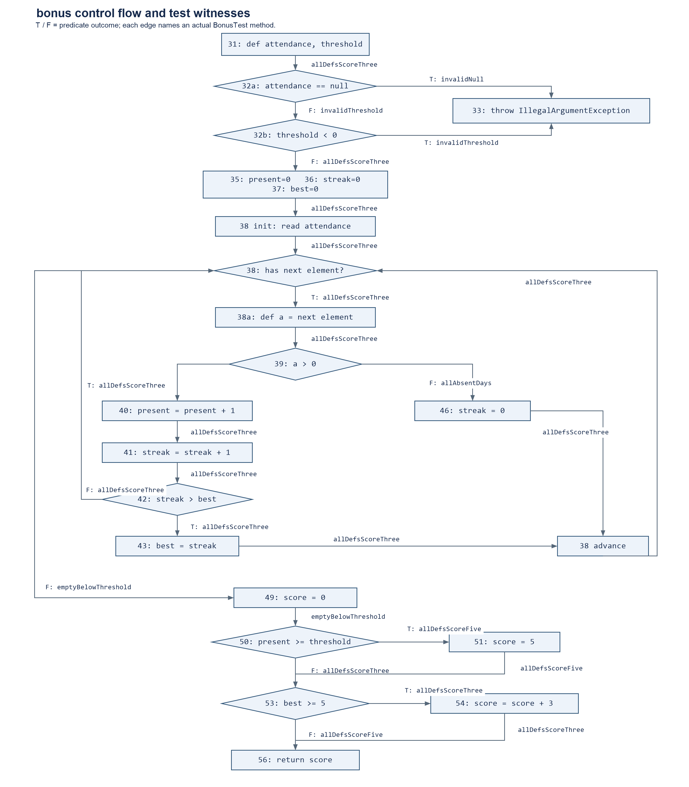

# Лаборатори 10 Өгөгдлийн урсгалын тест

**Нэр:** Ган-Оргил  
**Оюутны код:** B232270091  
**Хичээл:** F.CSA313 Программ хангамжийн чанарын баталгаа ба тест

`DataFlowTargets.java` эх кодын definition–use хосуудыг def-clear замаар
шинжилж, JUnit тестээр хамруулна. Эх кодын мөрийн дугаарлалтыг starter
хувилбараар авсан. Predicate-ийн use-ийг гарах T/F ирмэгээр нь тусад нь
тоолно. `d -> u` замд тухайн хувьсагчийг дахин тодорхойлоогүй байна;
`streak = streak + 1` зэрэг мөрийн RHS use нь LHS definition-ээс өмнө болно.

## Орчин

```text
java -version
openjdk version "17.0.21" 2026-10-20
OpenJDK Runtime Environment Temurin-17.0.21+9 (build 17.0.21+9)
OpenJDK 64-Bit Server VM Temurin-17.0.21+9 (build 17.0.21+9, mixed mode, sharing)

mvn -version
Apache Maven 3.9.16 (2bdd9fddda4b155ebf8000e807eb73fd829a51d5)
Maven home: C:\Users\enhta\Desktop\lab9\.lab10-work\tools\apache-maven-3.9.16
Java version: 17.0.21, vendor: Eclipse Adoptium, runtime: C:\Users\enhta\Desktop\lab9\.lab10-work\tools\jdk-17.0.21+9
Default locale: en_US, platform encoding: UTF-8
OS name: "windows 11", version: "10.0", arch: "amd64", family: "windows"
```

Maven Compiler Plugin-ийг 3.15.0 дээр тогтоосон тул хуучин Maven ч `release=17` тохиргоог хэрэглэнэ. `src/main` нь Starter-тэй ижил.

## A gcd

### Definition ба use

```text
13: def x, y                 // параметрийн эхний утгууд
14: int tmp                  // утга оноогоогүй тул definition биш
15: p-use y                  // T: 16 руу, F: 20 руу
16: c-use x, y; def tmp       // RHS-ийг уншсаны дараа tmp-д онооно
17: c-use y; def x
18: c-use tmp; def y
20: c-use x
```

### Бүх боломжит DU хос

| ID | Хувьсагч | Def мөр | Use мөр | Төрөл | Def-clear зам | Тестийн ID | Хамрагдсан |
|---|---|---:|---|---|---|---|---|
| GDU01 | x | 13 | 16 | c | 13 → 15T → 16 | G2, G3 | Тийм |
| GDU02 | x | 13 | 20 | c | 13 → 15F → 20 | G1 | Тийм |
| GDU03 | x | 17 | 16 | c | 17 → 18 → 15T → 16 | G2 | Тийм |
| GDU04 | x | 17 | 20 | c | 17 → 18 → 15F → 20 | G2, G3 | Тийм |
| GDU05 | y | 13 | 15T | p | 13 → 15T | G2, G3 | Тийм |
| GDU06 | y | 13 | 15F | p | 13 → 15F | G1 | Тийм |
| GDU07 | y | 13 | 16 | c | 13 → 15T → 16 | G2, G3 | Тийм |
| GDU08 | y | 13 | 17 | c | 13 → 15T → 16 → 17 | G2, G3 | Тийм |
| GDU09 | y | 18 | 15T | p | 18 → 15T | G2 | Тийм |
| GDU10 | y | 18 | 15F | p | 18 → 15F | G2, G3 | Тийм |
| GDU11 | y | 18 | 16 | c | 18 → 15T → 16 | G2 | Тийм |
| GDU12 | y | 18 | 17 | c | 18 → 15T → 16 → 17 | G2 | Тийм |
| GDU13 | tmp | 16 | 18 | c | 16 → 17 → 18 | G2, G3 | Тийм |

| ID | Бодит тестийн метод | Оролт | Expected | Зорилго |
|---|---|---|---:|---|
| G1 | `zeroSecondReturnsFirst` | gcd(7, 0) | 7 | Давталтгүй зам |
| G2 | `twoIterationsCoverRedefinitions` | gcd(12, 8) | 4 | Давталтын definition дараагийн давталтад хүрэх |
| G3 | `zeroFirstBecomesSecond` | gcd(0, 5) | 5 | Эхний параметр тэг байх тохиолдол |

`gcd(7, 0)` нь эхний `x`-ийг өөрчлөлтгүй return-д хүргэх **GDU02** болон
эхний `y`-ийн **GDU06** false ирмэгийг хамардаг. Давталт орвол 17-р мөр
`x`-ийн 13-р мөрийн definition-ийг kill хийнэ. `gcd(12, 8)` нь
`(12,8) → (8,4) → (4,0)` гэсэн хоёр давталттай тул GDU03, GDU09,
GDU11, GDU12-ыг хамарна. G1 ба G2 нийлээд хүснэгтийн бүх хосыг хамардаг;
G3 нь оролтын нэмэлт шалгалт юм. Гаралт: [results/mvn-verify-gcd.txt](results/mvn-verify-gcd.txt).

## B bonus эхний шат ALL DEFS

`BonusTest.java`-д `allDefsScoreThree` (B1) ба `allDefsScoreFive` (B2) гэсэн
**2 тест** all-defs хангана. Gcd-ийн 3 тесттэй нийлээд Maven **5 тест** ажиллуулна.

| Definition | Use-д хүргэх тест ба зам |
|---|---|
| attendance 31 | B1: 32aF, 38 init, 38T/F |
| threshold 31 | B1: 32bF, 50F; B2: 50T |
| a 38 | B1: 39T/F |
| present 35 | B1: эхний 40-ийн RHS |
| present 40 | B1: дараагийн 40-ийн RHS, эцэст нь 50F |
| streak 36 | B1: эхний 41-ийн RHS |
| streak 41 | B1: 42T/F, 43, дараагийн 41-ийн RHS |
| streak 46 | B1: тасалсны дараах 41-ийн RHS |
| best 37 | B1: эхний 42T |
| best 43 | B1: дараагийн 42T/F, 53T |
| score 49 | B1: 49 → 50F → 53T → 54 |
| score 51 | B2: 51 → 53F → 56 |
| score 54 | B1: 54 → 56 |

Нэг тест хүрэлцэхгүй. 49-р мөрийн `score` use-д хүрэх цорын ганц боломж нь
50F дараа 53T болж 54-ийн RHS-д уншигдах, эсвэл 50F ба 53F болж 56-д
уншигдах явдал юм. Харин 51-ийн definition-д хүрэхэд 50T байх ёстой;
51 нь 49-ийг use-ээс нь өмнө kill хийнэ. Иймээс score 49 ба 51-ийн
definition-үүдийг нэг гүйцэтгэлд хоёуланг нь use-д хүргэх боломжгүй, доод
хязгаар нь 2. Дээрх B1 ба B2 бусад definition-ийг мөн use-д хүргэж байгаа
тул энэ доод хязгаар биелсэн.

B1-ийн оролт `[1,1,1,1,1,0,1], threshold=8` тул present=6, best=5,
expected=3. B2-ийн `[0,1], threshold=1` тул present=1, best=1, expected=5.
Гаралт: [mvn-verify-alldefs.txt](results/mvn-verify-alldefs.txt),
[jacoco-alldefs.csv](results/jacoco-alldefs.csv).

Энэ шатанд DataFlowTargets-ийн branch нь **14/16**, line нь **22/24**.
Null/сөрөг threshold-ийн true ирмэг болон 33-р мөрийн throw хараахан
хамрагдаагүй. 7-р мөрийн далд constructor мөн хамрагдаагүй байна.
All-defs хангагдсан нь branch 100% гэсэн үг биш.


## B bonus бүрэн DU анализ

### B1 CFG



32-р мөрийн short circuit-ийг `32a: attendance == null`, `32b: threshold < 0`
гэж салгасан. 38-р мөрийн `init` нь массивын илэрхийллийг нэг удаа унших
c-use, `38T/F` нь дараагийн элемент байгаа эсэхийн p-use, `38a` нь дараагийн
элементийг `a`-д оноох definition юм. `38 advance` нь давталтын дараагийн
алхам руу шилжихийг тэмдэглэнэ. Зураг дахь ирмэг бүрд түүнийг дайрдаг нэг
бодит JUnit методын нэр бий; энэ нь тухайн ирмэгийг дайрдаг бүх тестийн
бүрэн жагсаалт гэсэн үг биш.

### B2 Definition ба use

```text
31: def attendance, threshold
32a: p-use attendance                  // null T/F
32b: p-use threshold                   // <0 T/F; 32aT үед үнэлэхгүй
33: throw                             // эдгээр хувьсагчийн def/use байхгүй
35: def present
36: def streak
37: def best
38 init: c-use attendance              // массивын илэрхийллийг унших
38 T/F: p-use attendance               // дараагийн элемент байгаа эсэх
38a: def a                            // дараагийн элементийг оноох
39: p-use a                           // >0 T/F
40: c-use present; def present
41: c-use streak; def streak
42: p-use streak, best                 // > T/F
43: c-use streak; def best
46: def streak                        // өмнөх streak definition-ийг KILL
49: def score
50: p-use present, threshold           // >= T/F
51: def score                         // 49-ийг KILL
53: p-use best                         // >=5 T/F
54: c-use score; def score             // RHS use эхэлж болно
56: c-use score
```

### B3 Бүх боломжит DU хос

Доорх хүснэгт p-use-ийн T/F ирмэгийг тусад нь авч **34 боломжит шаардлага**
тоолсон. `attendance`-ийн 38 init c-use-ийг тусад нь тооцохгүй, зөвхөн лабт
онцолсон 38T/F p-use-ийг тооцвол 33 болно; хоёр convention-ий бүх шаардлага
хамрагдсан. `38a` нь файлын 38-р мөрийн `a` definition, `init` нь мөн 38-р
мөрийн массивыг унших үе шатыг заана. Зам бүр definition-ээс тухайн use
хүртэл явна; өөр хувьсагчийн definition тухайн замыг таслахгүй.

| ID | Хувьсагч | Def мөр | Use мөр | c/p | Def-clear зам | Тестийн ID | Хамрагдсан |
|---|---|---:|---|---|---|---|---|
| BDU01 | a | 38 | 39F | p | 38a → 39F | B1, B2, B5 | Тийм |
| BDU02 | a | 38 | 39T | p | 38a → 39T | B1, B2, B6 | Тийм |
| BDU03 | attendance | 31 | 32aF | p | 31 → 32aF | B1, B2, B3, B4, B5, B6, B8 | Тийм |
| BDU04 | attendance | 31 | 32aT | p | 31 → 32aT | B7 | Тийм |
| BDU05 | attendance | 31 | 38 | c | 31 → 32aF → 32bF → 35 → 36 → 37 → 38init | B1, B2, B3, B4, B5, B6 | Тийм |
| BDU06 | attendance | 31 | 38F | p | 31 → 32aF → 32bF → 35 → 36 → 37 → 38init → 38F | B1, B2, B3, B4, B5, B6 | Тийм |
| BDU07 | attendance | 31 | 38T | p | 31 → 32aF → 32bF → 35 → 36 → 37 → 38init → 38T | B1, B2, B5, B6 | Тийм |
| BDU08 | best | 37 | 42T | p | 37 → 38init → 38T → 38a → 39T → 40 → 41 → 42T | B1, B2, B6 | Тийм |
| BDU09 | best | 37 | 53F | p | 37 → 38init → 38F → 49 → 50F → 53F | B3, B4, B5 | Тийм |
| BDU10 | best | 43 | 42F | p | 43 → 38T → 38a → 39F → 46 → 38T → 38a → 39T → 40 → 41 → 42F | B1 | Тийм |
| BDU11 | best | 43 | 42T | p | 43 → 38T → 38a → 39T → 40 → 41 → 42T | B1, B6 | Тийм |
| BDU12 | best | 43 | 53F | p | 43 → 38F → 49 → 50T → 51 → 53F | B2 | Тийм |
| BDU13 | best | 43 | 53T | p | 43 → 38F → 49 → 50T → 51 → 53T | B1, B6 | Тийм |
| BDU14 | present | 35 | 40 | c | 35 → 36 → 37 → 38init → 38T → 38a → 39T → 40 | B1, B2, B6 | Тийм |
| BDU15 | present | 35 | 50F | p | 35 → 36 → 37 → 38init → 38F → 49 → 50F | B3, B5 | Тийм |
| BDU16 | present | 35 | 50T | p | 35 → 36 → 37 → 38init → 38F → 49 → 50T | B4 | Тийм |
| BDU17 | present | 40 | 40 | c | 40 → 41 → 42T → 43 → 38T → 38a → 39T → 40 | B1, B6 | Тийм |
| BDU18 | present | 40 | 50F | p | 40 → 41 → 42F → 38F → 49 → 50F | B1 | Тийм |
| BDU19 | present | 40 | 50T | p | 40 → 41 → 42T → 43 → 38F → 49 → 50T | B2, B6 | Тийм |
| BDU20 | score | 49 | 54 | c | 49 → 50F → 53T → 54 | B1 | Тийм |
| BDU21 | score | 49 | 56 | c | 49 → 50F → 53F → 56 | B3, B5 | Тийм |
| BDU22 | score | 51 | 54 | c | 51 → 53T → 54 | B6 | Тийм |
| BDU23 | score | 51 | 56 | c | 51 → 53F → 56 | B2, B4 | Тийм |
| BDU24 | score | 54 | 56 | c | 54 → 56 | B1, B6 | Тийм |
| BDU25 | streak | 36 | 41 | c | 36 → 37 → 38init → 38T → 38a → 39T → 40 → 41 | B1, B6 | Тийм |
| BDU26 | streak | 41 | 41 | c | 41 → 42T → 43 → 38T → 38a → 39T → 40 → 41 | B1, B6 | Тийм |
| BDU27 | streak | 41 | 42F | p | 41 → 42F | B1 | Тийм |
| BDU28 | streak | 41 | 42T | p | 41 → 42T | B1, B2, B6 | Тийм |
| BDU29 | streak | 41 | 43 | c | 41 → 42T → 43 | B1, B2, B6 | Тийм |
| BDU30 | streak | 46 | 41 | c | 46 → 38T → 38a → 39T → 40 → 41 | B1, B2 | Тийм |
| BDU31 | threshold | 31 | 32bF | p | 31 → 32aF → 32bF | B1, B2, B3, B4, B5, B6 | Тийм |
| BDU32 | threshold | 31 | 32bT | p | 31 → 32aF → 32bT | B8 | Тийм |
| BDU33 | threshold | 31 | 50F | p | 31 → 32aF → 32bF → 35 → 36 → 37 → 38init → 38F → 49 → 50F | B1, B3, B5 | Тийм |
| BDU34 | threshold | 31 | 50T | p | 31 → 32aF → 32bF → 35 → 36 → 37 → 38init → 38F → 49 → 50T | B2, B4, B6 | Тийм |

**Kill.** 46-р мөр нь түүнд хүрч ирсэн `streak`-ийн 36, 41 эсвэл өмнөх
давталтын 46 definition-ийг kill хийнэ. 41-ийн шинэ definition мөн өмнөх
streak-ийг kill хийнэ, гэхдээ RHS use нь үүнээс өмнө хийгдэнэ. Иймээс
`41 → ... → 46 → ... → 41` зам дээр эхний 41-ийн утга дараагийн 41-ийн
RHS-д хүрэхгүй; хүснэгтийн 41→41 нь тасалдалгүй хоёр дараалсан ирцээр
биелнэ. 46 нь present, best, score-ийг kill хийхгүй.

| Хассан хос эсвэл салаа | Үндэслэл |
|---|---|
| streak 36→42, 36→43 | Аль ч замд 41 ажиллаж 36-ийн утгыг use-ээс өмнө kill хийнэ. |
| streak 46→42, 46→43 | Дараагийн эерэг a дээр 41 ажиллаж 46-г kill хийсний дараа л 42, 43-т хүрнэ. |
| best 37→42F | 37-ийн best=0 хэвээр бол энэ нь эхний эерэг ирц; 41-ийн streak=1 тул 42 заавал T. |
| best 37→53T | 43 ажиллаагүй үед best=0, тиймээс best>=5 үнэн болохгүй. |
| score 54→54 | 54-өөс буцах давталтын ирмэг байхгүй учир ижил гүйцэтгэлд дахин 54-т хүрэхгүй. |
| score 49→56, 50T-ээр дайрсан зам | 51 нь 49-ийг kill хийнэ; зөвхөн 50F, 53F зам нь хүснэгтийн 49→56 хос болно. |
| present 35→50, 40-өөр дайрсан зам | Эхний 40 нь 35-ийг kill хийнэ; 35→50 нь зөвхөн эерэг ирцгүй үед биелнэ. |
| threshold 31→32b, 32aT зам | Short circuit-ийн улмаас threshold-ийг энэ зам дээр уншихгүй; 32b нь non-null attendance-тай үед л use болно. |

### B4 ALL DU PAIRS тестүүд

| ID | Бодит метод | attendance | threshold | Expected |
|---|---|---|---:|---|
| B1 | `allDefsScoreThree` | [1,1,1,1,1,0,1] | 8 | 3 |
| B2 | `allDefsScoreFive` | [0,1] | 1 | 5 |
| B3 | `emptyBelowThreshold` | [] | 1 | 0 |
| B4 | `emptyThresholdZero` | [] | 0 | 5 |
| B5 | `allAbsentDays` | [0,-1,0] | 1 | 0 |
| B6 | `fivePresentDays` | [1,1,1,1,1] | 5 | 8 |
| B7 | `invalidNull` | null | 0 | IllegalArgumentException |
| B8 | `invalidThreshold` | [] | -1 | IllegalArgumentException |

ALL-DEFS шатны B1/B2 дээр B3–B8-ыг нэмсэн. Энэ шатанд bonus-ийн **8**,
gcd-ийн **3**, нийт **11 тест** тэнцсэн. B3 нь score 49→56, B4 нь present
35→50T, B6 нь score 51→54-ийг шинээр хамарна. B7/B8 нь validation-ийн хоёр
true ирмэгийг хамруулна. Гаралт:
[mvn-verify-alldu.txt](results/mvn-verify-alldu.txt),
[jacoco-alldu.csv](results/jacoco-alldu.csv).

### Branch ба DU хамралтын ялгаа

ALL-DEFS-ийн branch 14/16 буюу 87.5% боловч бүх definition ядаж нэг use-д
хүрсэн. ALL-DU шатанд branch 16/16 буюу 100% болсон. Гэхдээ branch 100%
болох нь DU хос бүрийг хамарсныг дангаараа батлахгүй. Жишээ нь B1, B2, B7,
B8 нь бүх branch-ийг хамарна: B1 дотор 39T/F, 42T/F, 38T/F; B1/B2 дотор
50T/F, 53T/F; B7/B8 дотор 32aT/F, 32bT/F бий. Тэгсэн ч энэ дөрвөн
тестэд `score 49→56` ба `score 51→54`, `present 35→50T/F`, `best 37→53F`
хосууд байхгүй. Энэ subset-ийг gcd-ийн 3 тесттэй хамт тусад нь ажиллуулж
**7 тест**, branch **16/16** гарсныг
[mvn-verify-branch-only.txt](results/mvn-verify-branch-only.txt),
[jacoco-branch-only.csv](results/jacoco-branch-only.csv)-д хадгалсан.
DU хүснэгт нь нэг use-д аль definition-ээс ирснийг ялгадаг; JaCoCo branch
нь энэ мэдээллийг хэмждэггүй.


## AI тусламж

OpenAI Codex-ийг DU шинжилгээ, тест бичих, тест ажиллуулах болон тайлангийн
найруулга, GitHub-д байршуулахад ашиглав. Хамралт, мутацийн үр дүнг бодит
Maven гаралттай тулгана.
